<!-- Animated hero: inline SVG uses only GitHub-supported image rendering. -->

  

  
  
  

---

## `01` — About

I'm a **B.Tech Computer Science & Engineering (Applied AI)** student at **St. Joseph University**, learning by building practical software.

- Building with **React, JavaScript, Python, HTML, and CSS**
- Exploring **Applied AI, backend development, and automation**
- Interested in **Linux, cybersecurity, and cloud security**
- Currently strengthening my skills in **Node.js, Express, databases, and APIs**

> I prefer shipping useful projects, learning from the process, and improving them step by step.

## `02` — Tech stack

Core skills: Python · JavaScript · React · HTML · CSS · Git · Linux 
Learning / exploring: Node.js · Express · MongoDB · Supabase · Firebase · API development

## `03` — Selected projects

<table>
  <tr>
    <td width="50%" valign="top">
      <h3>Attend Flow</h3>
      
Attendance dashboard and email-automation workflow designed to make attendance communication easier.

      React · APIs · Backend workflows · Database integration
    </td>
    <td width="50%" valign="top">
      <h3>Welfare AI</h3>
      
An AI-driven concept for helping people discover potentially relevant Indian government welfare schemes.

      React · AI integration · User-focused design
    </td>
  </tr>
  <tr>
    <td width="50%" valign="top">
      <h3>CommitForge AI</h3>
      
Exploring AI-assisted developer workflows.

      <a href="https://github.com/Partha1107/CommitForge-AI">View repository ↗</a>
    </td>
    <td width="50%" valign="top">
      <h3>What I'm exploring</h3>
      
Applied AI, clean UI, REST APIs, Linux workflows, and security fundamentals.

      Learning in public · Improving with every build
    </td>
  </tr>
</table>

## `04` — GitHub activity

## `05` — Currently learning

- Building and documenting REST APIs
- Backend development with Node.js and Express
- Database design, authentication, and integration
- Applied AI integration and responsible product design
- Linux workflows and security fundamentals

---

Open to learning, collaboration, and building useful things with other developers.

